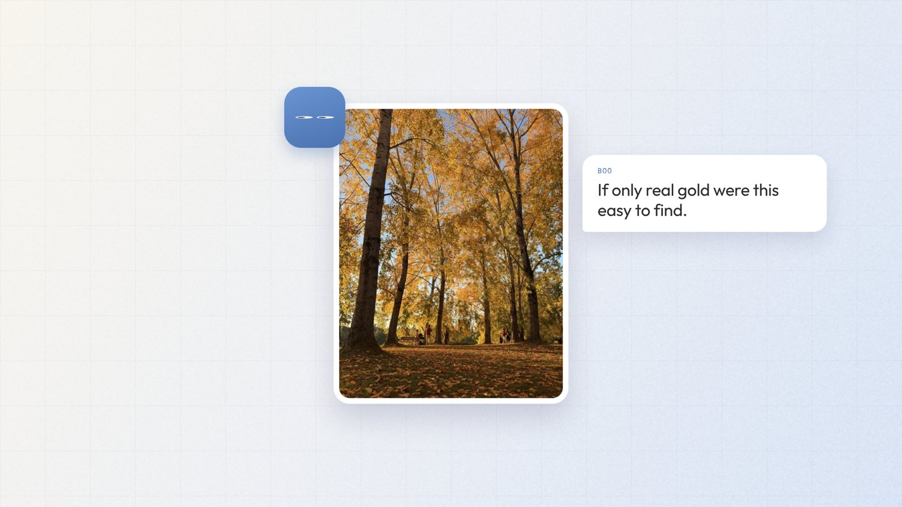

# Peekaboo

A photo buddy that gets me to look up.

Photography has always been a hobby of mine, but these days my mind is always full and the small moments go by without me noticing. Peekaboo gives me a reason to look up again.

Every morning, Boo, a pair of curious eyes, looks at the weather forecast, the daylight and the season, and gives me one small thing to go photograph. When I take a photo, Boo reacts, adds it to my month, and tells me if it fits an open photography contest.

**Try it:** [peekaboo-two.vercel.app](https://peekaboo-two.vercel.app)

## How it's built

- **App:** Next.js on Vercel
- **Daily job:** Vercel Cron checks the forecast each morning and writes the day's spot
- **Weather and light:** Open-Meteo
- **Photos and memory:** Supabase (Postgres and Storage)
- **Boo:** Gemini Flash reads each photo and writes everything Boo says
- **Cost:** every piece runs on a free plan

Designed and built by [Manya Singh](https://www.manyasingh.in) with Claude.
